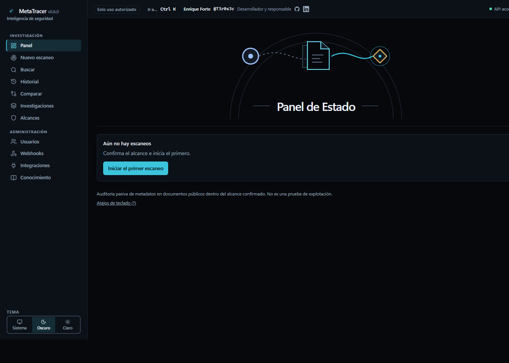
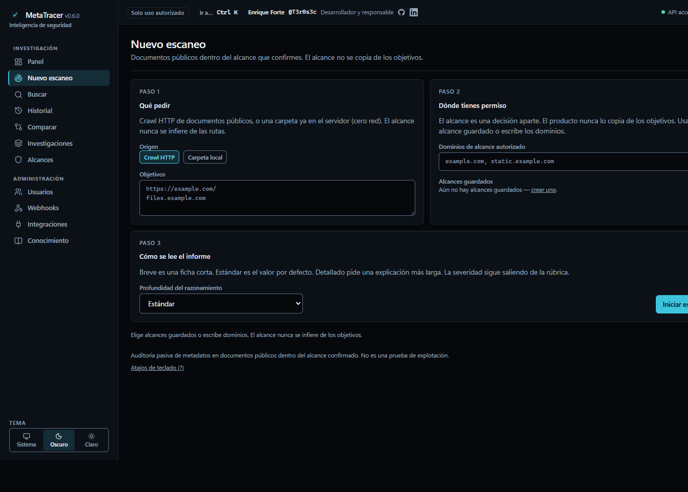
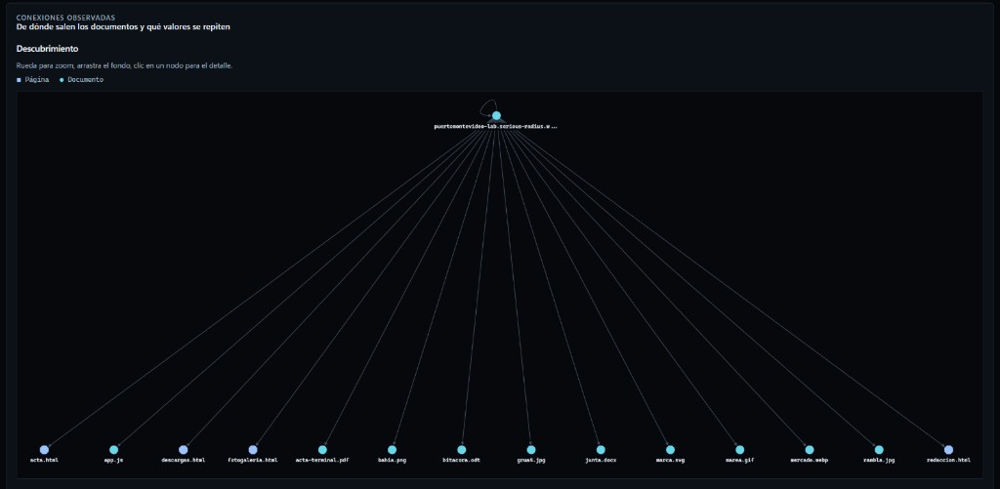
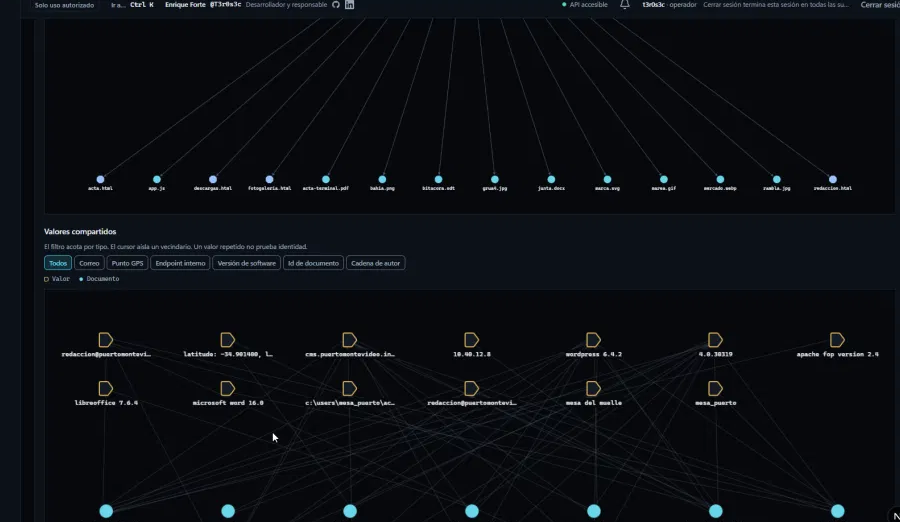
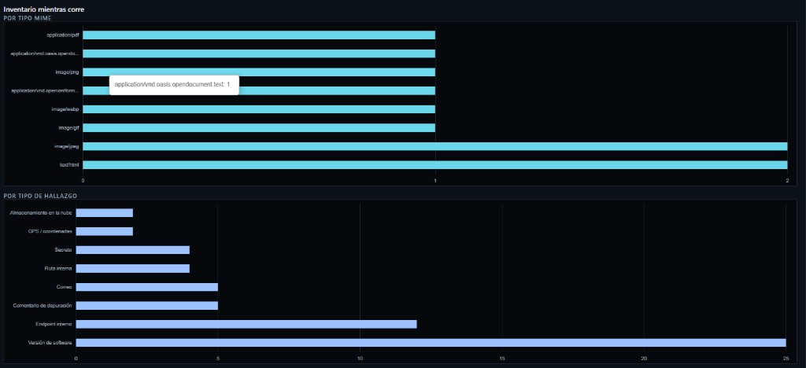
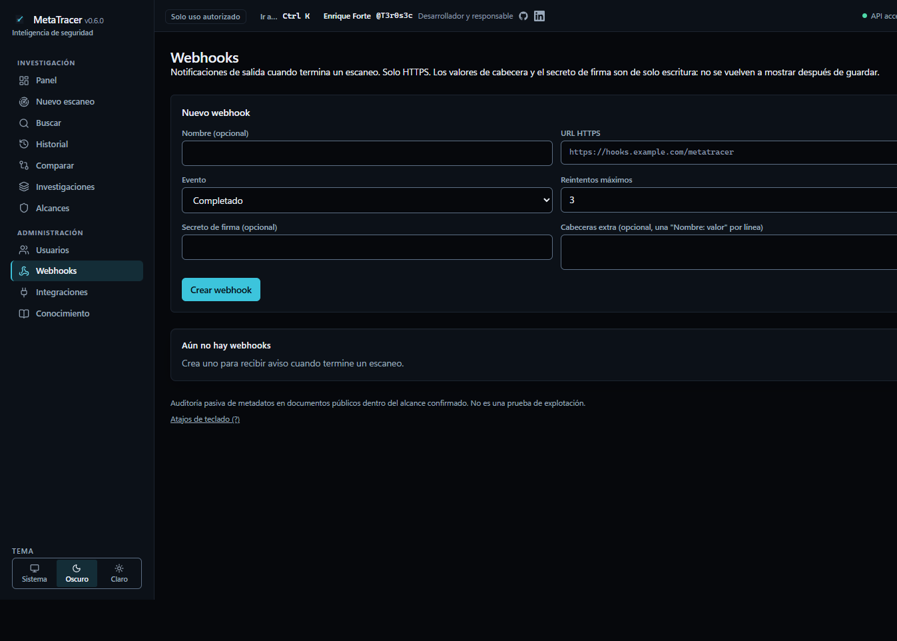

# MetaTracer


**Descubre metadatos sensibles en archivos y sitios web que tienes autorización para analizar.**

MetaTracer te ayuda a identificar información que puede quedar expuesta sin que sus propietarios lo sepan. Por ejemplo, una fotografía puede contener coordenadas GPS y un documento PDF puede incluir el nombre de su autor, rutas internas o la versión del programa con el que se creó.

La aplicación reúne estos datos y los presenta como hallazgos que puedes revisar, clasificar y exportar en un informe.

[Instalación](#instalación) · [Primer escaneo](#primer-escaneo) · [Funcionalidades](#funcionalidades) · [Tecnologías](#tecnologías) · [Documentación](#documentación)

> **Uso autorizado:** utiliza MetaTracer únicamente en sistemas y archivos propios o cuando tengas permiso explícito para analizarlos. Antes de iniciar un escaneo, la aplicación solicita que indiques y confirmes el alcance autorizado.

## ¿Para quién es?

MetaTracer está pensado para profesionales y estudiantes de ciberseguridad que quieran revisar la exposición de información en:

- Auditorías de seguridad autorizadas.
- Programas de bug bounty, respetando sus condiciones y alcance.
- Sitios web y archivos propios.
- Laboratorios y entornos de práctica autorizados.

Si estás empezando, puedes utilizar la interfaz web y seguir el proceso guiado. Si ya tienes experiencia, también puedes trabajar desde la terminal o consultar la API.

## ¿Qué puede encontrar?

MetaTracer analiza metadatos y fragmentos concretos de información para identificar posibles exposiciones, como las siguientes:

| Tipo de información | Ejemplo |
| --- | --- |
| Coordenadas GPS | Ubicación incluida en los metadatos de una fotografía. |
| Correos electrónicos | Direcciones presentes en metadatos o comentarios. |
| Rutas internas | Rutas de archivos o carpetas de un equipo o servidor. |
| Versiones de software | Programas y versiones presentes en documentos o cabeceras HTTP. |
| Comentarios de desarrollo | Comentarios en HTML o JavaScript que pueden revelar información interna. |
| Direcciones y servicios internos | Referencias a redes privadas o dominios internos. |
| Almacenamiento en la nube | Referencias a servicios como Amazon S3, Google Cloud Storage o Azure Blob. |
| Posibles secretos | Algunos patrones de claves o tokens encontrados en la información ya extraída. |

Puede analizar imágenes, PDF, documentos de oficina, páginas HTML, cabeceras HTTP y comentarios de JavaScript. También permite revisar archivos de una carpeta local.

> Los resultados son indicios que debe revisar una persona. La presencia de un dato no siempre significa que exista una vulnerabilidad.

## Funcionalidades

- **Escaneos web y locales:** analiza recursos públicos dentro del alcance autorizado o archivos que ya tengas en tu equipo.
- **Interfaz web en español:** inicia escaneos y consulta resultados desde el navegador.
- **Gestión de hallazgos:** marca cada resultado como abierto, confirmado, falso positivo o corregido.
- **Historial y comparación:** consulta escaneos anteriores y compara sus resultados.
- **Investigaciones:** agrupa varios escaneos relacionados con un mismo trabajo.
- **Grafos:** visualiza cómo se descubrieron los recursos y qué valores aparecen en varios archivos.
- **Informes:** exporta los resultados en Markdown, JSON, HTML, CSV o mediante una plantilla para bug bounty.
- **Herramientas para usuarios avanzados:** utiliza la CLI, la API, webhooks e integraciones opcionales.

### Análisis con IA opcional

La detección de información se realiza mediante reglas. Si configuras un modelo de lenguaje, MetaTracer puede utilizarlo para ayudar a interpretar los hallazgos detectados. Sin un modelo configurado, la aplicación sigue funcionando con su clasificación heurística.

El sistema incorpora comprobaciones para limitar las respuestas del modelo a la evidencia disponible. El contenido enviado al modelo se basa en metadatos y fragmentos de texto; los archivos completos no se envían al modelo.

## Vista de la aplicación

### Panel de estado

Consulta el resumen de escaneos, activos y hallazgos, así como su distribución por severidad y tipo.



### Nuevo escaneo

Indica qué quieres analizar, define el alcance autorizado y configura el escaneo desde la interfaz.



### Grafo de descubrimiento

Explora cómo se relacionan las páginas y los archivos encontrados durante un escaneo.



### Valores compartidos

Visualiza los valores que aparecen en varios archivos, como una dirección de correo o una versión de software. Un valor compartido no demuestra que exista una misma identidad detrás de los recursos.



### Inventario del escaneo

Revisa cómo se distribuyen los recursos por tipo de archivo y los resultados por tipo de hallazgo.



### Webhooks

Configura notificaciones HTTPS para recibir un resumen cuando un escaneo termina, falla o se aborta.



Puedes consultar más capturas y detalles en la [guía de uso](docs/user-guide.md).

## Requisitos

Para instalar MetaTracer de forma local necesitas:

| Herramienta | Versión |
| --- | --- |
| Git | Para descargar el repositorio. |
| Python | 3.11 o 3.12. |
| Node.js | 20 o posterior, con npm. |
| Docker y Docker Compose | Opcionales, si prefieres ejecutar la aplicación con contenedores. |

> Python 3.13 no está soportado en esta versión.

## Instalación

Clona el repositorio y entra en la carpeta del proyecto:

```bash
git clone https://github.com/EnriqueForte/MetaTracer.git
cd MetaTracer
```

### Windows

Ejecuta el instalador:

```powershell
.\install.cmd
```

Cuando termine, inicia la aplicación:

```powershell
.\MetaTracer.cmd
```

También puedes abrir ambos archivos con doble clic desde el explorador de Windows.

### Linux

Da permisos de ejecución a los scripts y ejecuta el instalador:

```bash
chmod +x install.sh run.sh
./install.sh
```

Después, inicia la aplicación:

```bash
./run.sh
```

El instalador prepara el entorno de Python, instala las dependencias de la interfaz web y crea el archivo de configuración inicial si todavía no existe.

Abre la interfaz en [http://127.0.0.1:3000](http://127.0.0.1:3000) y mantén la terminal abierta mientras utilizas la aplicación. Para detenerla, pulsa `Ctrl + C` en la terminal.

Si necesitas ayuda con la instalación, consulta la [guía de instalación y solución de problemas](docs/installation.md).

## Primer escaneo

1. **Crea la primera cuenta.** Al iniciar MetaTracer por primera vez, selecciona la opción para crearla e introduce el token de configuración que aparece en la terminal.
2. **Elige qué quieres analizar.** Puedes indicar un sitio web público o seleccionar una carpeta local de la máquina donde se ejecuta MetaTracer.
3. **Define el alcance autorizado.** Indica los dominios incluidos en el trabajo o selecciona un alcance guardado. MetaTracer no deduce automáticamente el permiso a partir de la URL.
4. **Confirma la autorización e inicia el escaneo.** Revisa que el objetivo y el alcance sean correctos antes de continuar.
5. **Revisa los resultados.** Cuando termine, abre el escaneo desde el historial para consultar los hallazgos, clasificarlos y exportar un informe.

El acceso a direcciones locales y redes privadas está bloqueado para los escaneos web. Para analizar archivos de tu equipo, utiliza la opción de carpeta local.

Encontrarás ejemplos y una explicación de cada pantalla en la [guía de uso](docs/user-guide.md).

## Uso desde la terminal

Si prefieres trabajar con la CLI, puedes iniciar un escaneo indicando el objetivo y el dominio autorizado:

```bash
.venv/bin/python -m metatracer scan example.com -s example.com -y
```

En Windows, sustituye `.venv/bin/python` por `.venv\Scripts\python.exe`.

En el ejemplo:

- `example.com` es el objetivo.
- `-s example.com` indica el dominio autorizado.
- `-y` confirma la autorización sin mostrar una pregunta interactiva.

**Sustituye el dominio por uno que tengas permiso para analizar.** Usar `-y` no concede autorización; únicamente registra tu confirmación.

Los comandos y opciones disponibles están en la [guía de la CLI](docs/cli.md).

## Docker

También puedes iniciar MetaTracer con Docker Compose:

```bash
docker compose up --build
```

Una vez arrancado, abre [http://localhost:8000](http://localhost:8000).

La configuración de los servicios y el uso de la CLI con contenedores se explican en la [guía de Docker](docs/docker.md).

## Tecnologías

MetaTracer está desarrollado con:

- **Python y FastAPI** para el motor y la API.
- **Next.js, React y TypeScript** para la interfaz web.
- **LangGraph** para el flujo opcional de análisis con modelos de lenguaje.
- **SQLite o PostgreSQL** para almacenar los datos de la aplicación.

## Documentación

| Documento | Contenido |
| --- | --- |
| [Instalación y solución de problemas](docs/installation.md) | Requisitos, instalación en Windows y Linux, y problemas frecuentes. |
| [Guía de uso](docs/user-guide.md) | Primer escaneo, resultados, investigaciones y funciones de la interfaz. |
| [Guía de la CLI](docs/cli.md) | Comandos y ejemplos para trabajar desde la terminal. |
| [Docker](docs/docker.md) | Puesta en marcha y configuración con contenedores. |
| [Configuración y privacidad](docs/configuration.md) | Variables de entorno, modelos de lenguaje y tratamiento de la información. |
| [Arquitectura](docs/architecture.md) | Componentes y recorrido de los datos por la aplicación. |
| [Estado actual del producto](specs/current.md) | Funcionalidades y límites documentados del proyecto. |
| [Pruebas](tests/README.md) | Información para ejecutar y entender las pruebas. |

## Autor

**Enrique Forte · @t3r0s3c**

[GitHub](https://github.com/EnriqueForte) · [LinkedIn](https://linkedin.com/in/enriqueforte)
