# Guía de uso

[Volver al README](../README.md)

## Primer escaneo

1. El lanzador abre [http://127.0.0.1:3000/login](http://127.0.0.1:3000/login).
   Si la base está vacía, usa **Crear la primera cuenta** (`/setup`) y pega el
   token `SETUP MODE` que sale **una vez** en la terminal.
2. Crea un scan, indica el host **y el scope**. El scope no se infiere.
3. Confirma que estás autorizado. Sin esa confirmación no hay HTTP.
4. Revisa hallazgos, triaje (`open` / `confirmed` / `false_positive` / `fixed`)
   y exporta el informe (Markdown, JSON, HTML, CSV o plantilla bounty, **en inglés**).

Loopback y redes privadas están bloqueados. No uses la app contra `localhost`
salvo la suite de tests. Un overlay de extensión no impide escanear.

CLI equivalente (Linux):

```bash
.venv/bin/python -m metatracer scan example.com -s example.com -y
```

Windows: `.venv\Scripts\python.exe` en lugar de `.venv/bin/python`. `-y`
confirma el alcance sin pregunta interactiva.

Para un primer recorrido sin un programa de bug bounty, usa el [sitio de prueba](#sitio-de-prueba).

## Sitio de prueba

[Puertomontevideo](https://puertomontevideo-lab.serious-radius.workers.dev) es un semanario portuario **ficticio** publicado por este proyecto. Sirve para ejercitar el crawl en HTTPS: loopback sigue bloqueado, así que `localhost` no vale.

| Campo | Valor |
| --- | --- |
| Objetivo | `https://puertomontevideo-lab.serious-radius.workers.dev` |
| Scope | `puertomontevideo-lab.serious-radius.workers.dev` |

El scope es el host entero. `workers.dev` a secas queda fuera de alcance.

```bash
.venv/bin/python -m metatracer scan https://puertomontevideo-lab.serious-radius.workers.dev -s puertomontevideo-lab.serious-radius.workers.dev -y
```

Qué hay plantado (fotos, actas, metadata) está en [`../lab/puertomontevideo/README.md`](../lab/puertomontevideo/README.md). No es un medio real ni un target de terceros.

## La aplicación

La interfaz está en español y vive en [http://127.0.0.1:3000](http://127.0.0.1:3000). Al arrancar con `MetaTracer.cmd` o `./run.sh` pide login. La primera vez el log de la API imprime un token de setup: con eso creas el operador en `/setup`. A partir de ahí entras con usuario y contraseña.

La CLI en localhost no pide login. Habla con el mismo motor.

Arriba a la derecha tienes la campana (un escaneo que acaba, falla o se aborta), el buscador rápido `Ctrl+K` y el tema (sistema, oscuro o claro). El aviso de «solo uso autorizado» está siempre a mano.

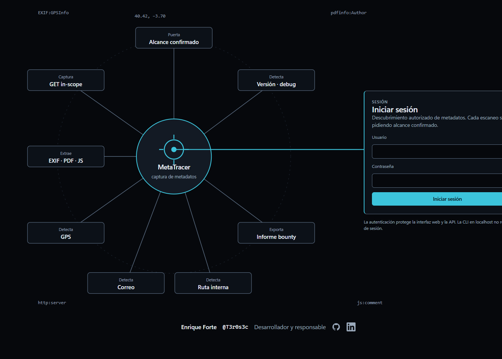

### Nuevo escaneo

Es la pantalla de inicio. Tres pasos, y el segundo no se rellena solo.

1. Qué pedir. **Crawl HTTP** para páginas y ficheros públicos, o **Carpeta local** si los ficheros ya están en la máquina donde corre MetaTracer. La carpeta local no abre red y no descomprime ZIP.
2. Dónde tienes permiso. Escribes los dominios, o eliges un alcance guardado. El producto no los copia de la URL.
3. Cómo de largo quieres el texto del informe: breve, estándar o detallado. La severidad sale de la rúbrica igual en los tres.

Sin la confirmación de alcance no hay petición HTTP.

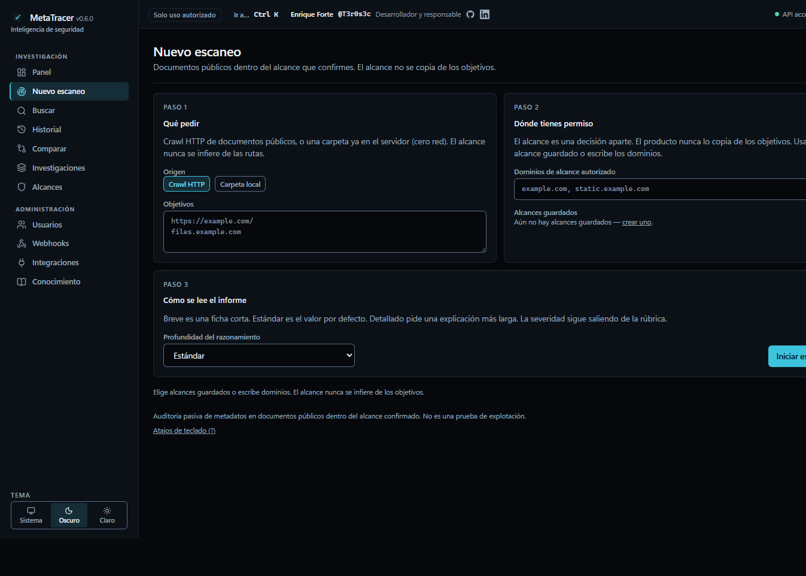

Cuando el run termina, ábrelo desde el historial. Ahí están los hallazgos (con triaje), los assets, la metadata, la cobertura y dos grafos. El de descubrimiento es el crawl: de qué página salió cada fichero. El de valores compartidos junta lo que se repite (un correo, una versión, una coordenada) sin tratarlo como si fuera la misma persona. El informe se exporta en Markdown, JSON, HTML, CSV o plantilla bounty, en inglés.

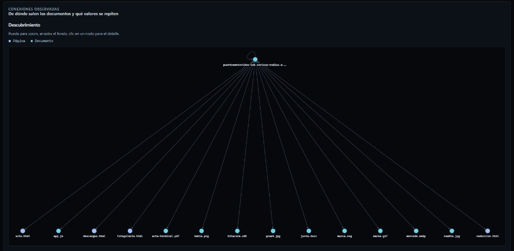

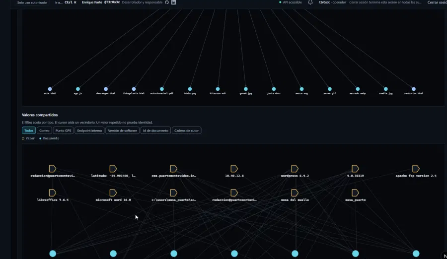

En la misma ficha, mientras el run está en marcha o ya cerrado, hay dos barras: qué tipos de fichero entraron y cómo se reparten los hallazgos.

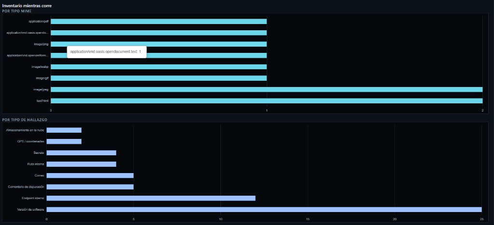

El triaje lo marcas tú: `open`, `confirmed`, `false_positive` o `fixed`. Marcar un falso positivo no reescribe la evidencia.

### Panel

El resumen de lo que ya has corrido en esta instalación: cuántos escaneos, hallazgos y assets hay, cómo se reparte la severidad y qué tipos salen más. Si todavía no hay runs, te manda al primero.

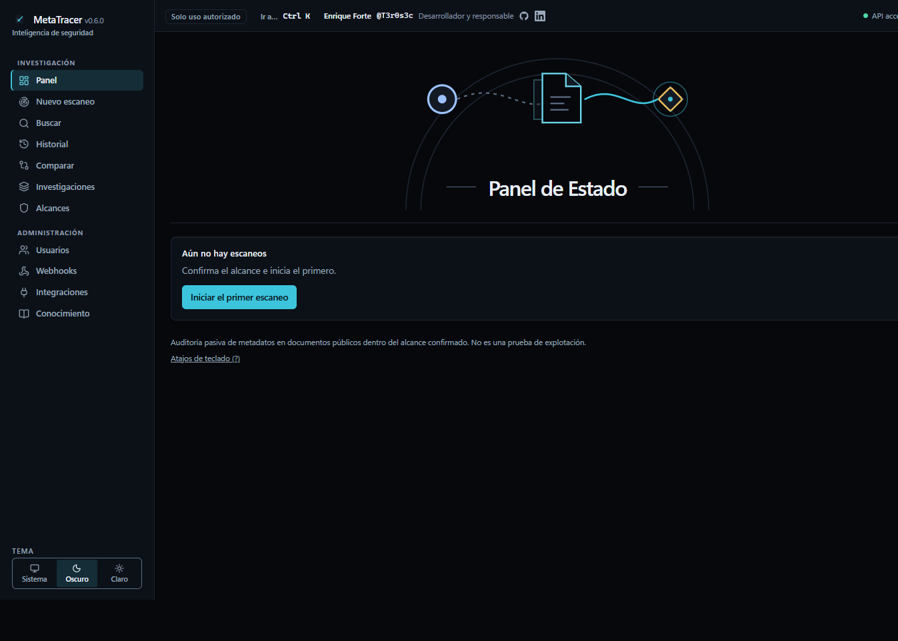

### Buscar

Busca en lo que ya está guardado. No lanza un crawl. Puedes quedarte en hallazgos, en metadata, o en los dos, filtrar por tipo, namespace, severidad y triaje. El modo léxico busca el texto. «Similar» usa el índice local de precedentes, si lo tienes.

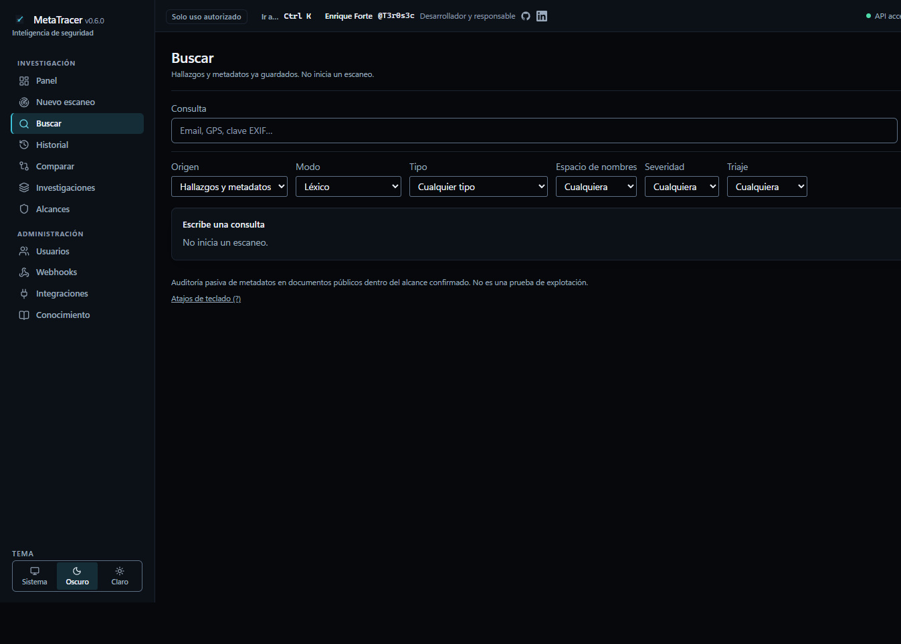

### Historial

La lista de escaneos de esta máquina, con filtro por estado. Desde aquí reabres un run, vuelves a exportar o marcas dos para compararlos. No es un panel de varios clientes.

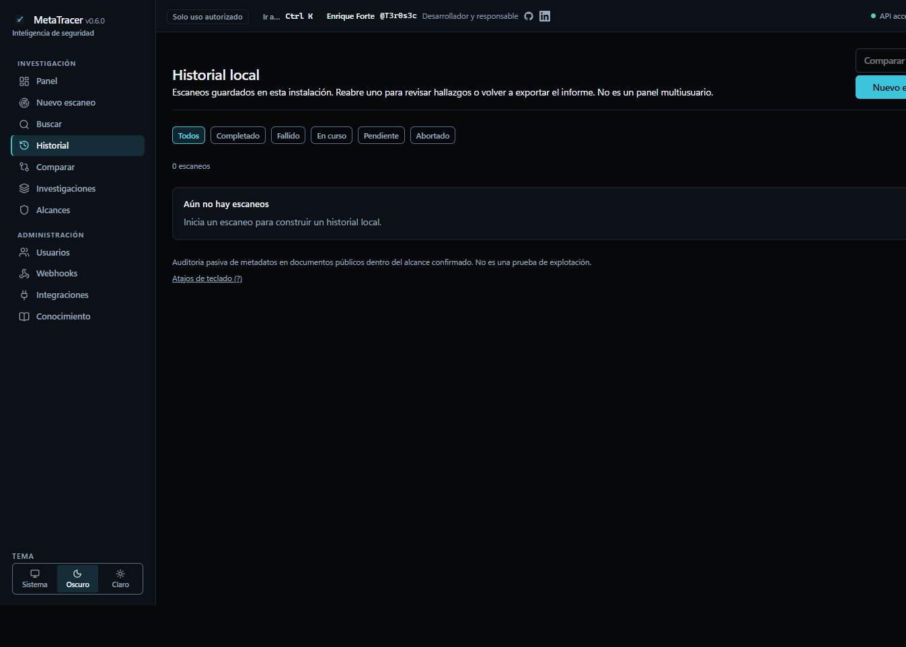

### Comparar

Pones un escaneo de línea base y otro más reciente. Empareja hallazgos por URL del asset, tipo y evidencia, para ver qué apareció, qué se fue y qué cambió de severidad.

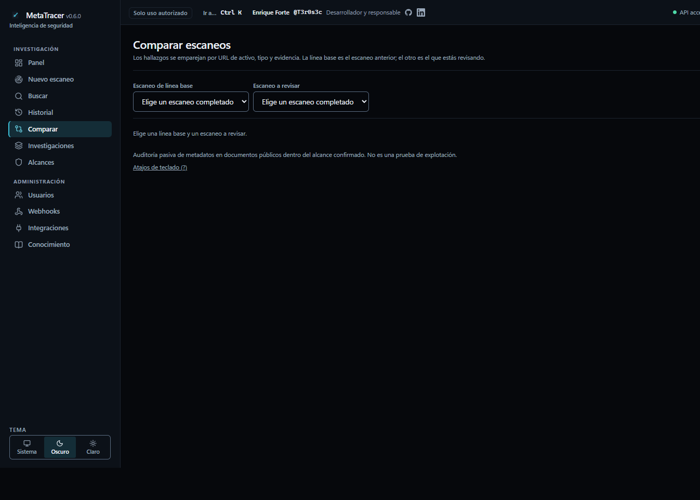

### Investigaciones

Un grupo con nombre para varios runs del mismo encargo. Si un hallazgo ya lo triaste en otro run del grupo, la ficha te lo sugiere. No lo aplica solo, y compartir un email o un punto GPS no significa que sea la misma persona.

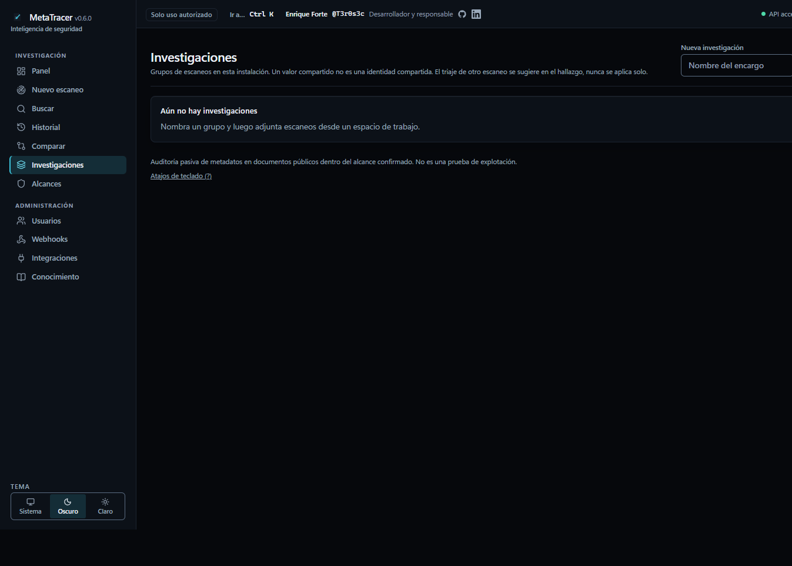

### Alcances

Dominios que vas a reutilizar. Al escanear se copian al run, así que si luego editas o borras el alcance, los escaneos viejos se quedan como estaban. También puedes importar un JSON de alcances (hasta 5 MiB); si el nombre ya existe, se omite.

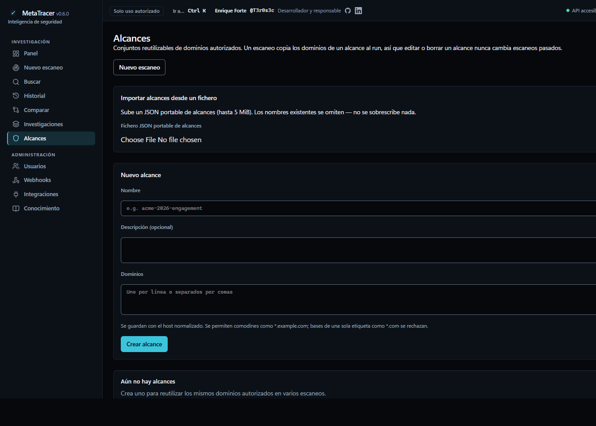

### Usuarios

Cuentas de esta instalación. El operador puede crear usuarios e invitaciones de un solo uso. El visor entra a mirar y no cambia triaje, webhooks ni usuarios. El primer operador sale del setup, no de esta lista.

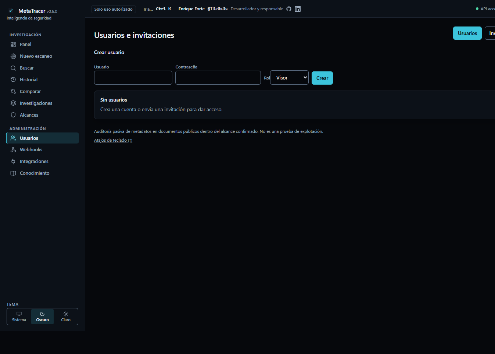

### Webhooks

Un aviso HTTPS cuando un escaneo lanzado desde la interfaz termina, falla o se aborta. El cuerpo es un resumen: referencia del run, contadores y un texto corto. No van coordenadas, correos ni la lista de hallazgos.

La URL tiene que ser `https://`. `localhost` y las IPs privadas se rechazan. Si pones un secreto, cada POST lleva `X-MetaTracer-Timestamp` y `X-MetaTracer-Signature` (`sha256=` del HMAC de `{timestamp}.{cuerpo}`). El secreto no se vuelve a mostrar.

`metatracer scan` por terminal no dispara estos avisos. `watch --webhook <id>` sí, en cada iteración, y entonces `new_findings`, `resolved_findings` y `severity_up_count` comparan con el run anterior del mismo alcance.

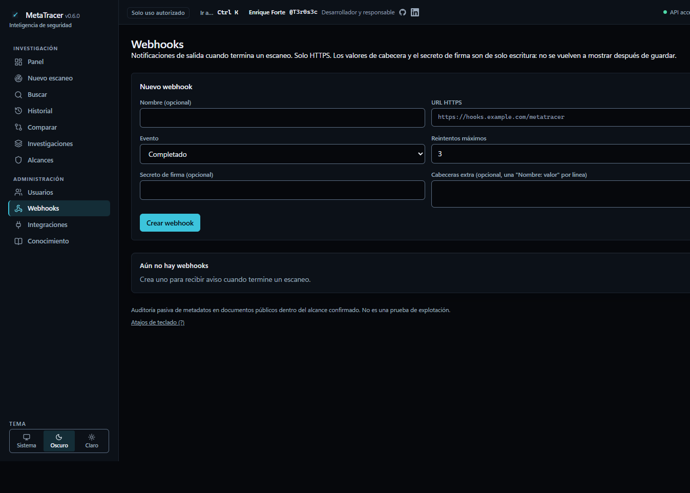

Puedes usar [Webhook.site](https://webhook.site) para comprobar el JSON sin montar un receptor propio. La página del receptor puede ser accesible para quien tenga su enlace, así que evita usar secretos reales o datos sensibles en la prueba.

Este es un ejemplo ficticio del cuerpo que puede recibir el servicio:

```json
{
  "run_id": "00000000-0000-4000-8000-000000000001",
  "run_ref": "ejemplo1",
  "event": "completed",
  "target": "https://example.com",
  "total_assets": 12,
  "total_findings": 59,
  "new_findings": 0,
  "resolved_findings": 0,
  "severity_up_count": 0,
  "executive_summary": "Example scan completed.",
  "error_message": null
}
```

Los valores son ilustrativos. Utiliza únicamente objetivos que tengas autorización para analizar.

### Integraciones

Consultas sueltas a tres índices públicos. Nacen apagadas. Encender una no mete hosts nuevos en el alcance y no crea hallazgos.

Escribes un dominio, sin `https://`.

- **RDAP.** Registrador, estados, nameservers y fechas. El titular suele venir tapado.
- **Wayback.** Fechas en las que Internet Archive vio ese dominio. No descarga la página archivada.
- **Common Crawl.** Filas del índice público. No baja los ficheros WARC. Si el índice tarda o responde 504, la ficha queda en degradado y el escaneo que tengas en marcha sigue.

El lab de Puertomontevideo aquí no aporta: es un nombre `workers.dev` reciente. Para probar RDAP o Wayback, `example.com` es un dominio público de ejemplo. No lances un scan de MetaTracer contra sitios que no tengas autorizados.

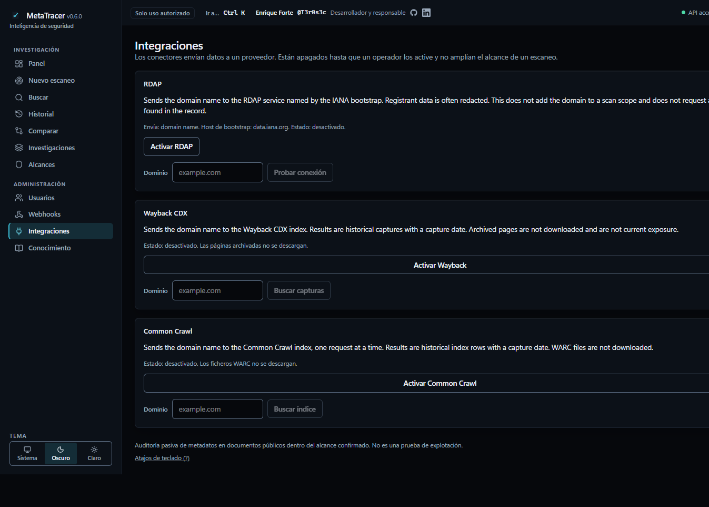

### Conocimiento

Una libreta de precedentes para el agente: tipo de hallazgo, un fragmento corto, severidad y título. Se exporta e importa en JSON (hasta 5 MiB) para llevarla a otra instalación. No guarda ids de escaneo, metadata cruda ni bytes de ficheros.

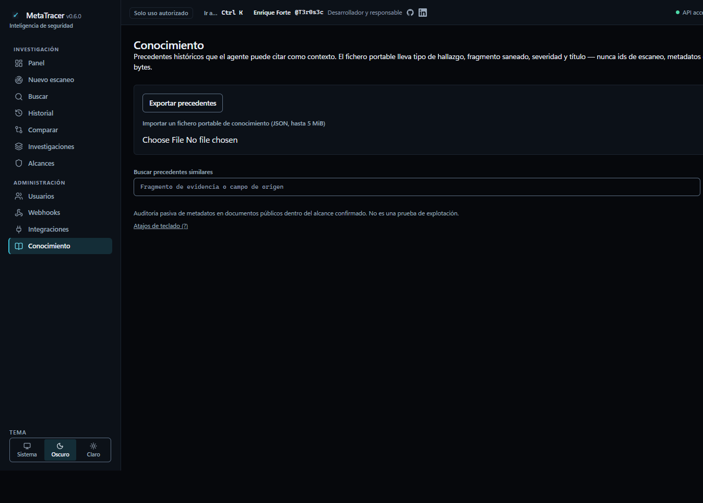

## Qué detecta

| Tipo | Ejemplos |
| --- | --- |
| `gps` | Coordenadas EXIF / IPTC |
| `email` | Correos en metadata y comentarios |
| `internal_path` | Rutas de disco o UNC |
| `software_version` | Producto y versión en PDF / cabeceras |
| `debug_comment` | Comentarios HTML/JS de desarrollo |
| `internal_endpoint` | Hosts `.internal` / RFC1918 en metadata |
| `cloud_storage` | Hosts S3, GCS, Azure Blob, R2 |
| `secret` | Allowlist: `AKIA`, `ghp_`, PEM, JWT compacto **ya extraídos** |

Fuentes: JPEG/PNG/TIFF/WebP/GIF, SVG (solo RDF/metadata, nunca el dibujo),
PDF, HTML, cabeceras HTTP, comentarios JS, propiedades OOXML/ODF (nunca el
cuerpo). También una **carpeta local** (`--local` / `local_paths`): mismos
extractores, cero red. No se descomprimen ZIP genéricos ni se piden HEIC/AVIF.
